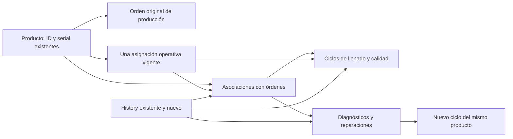

# Fase 1: estructuras de trazabilidad de producción

Esta fase prepara la base de datos y las relaciones. No activa selección por serial,
rechazos, agrupación Review, reparación ni distribución individual. No registra nuevos
tipos, estados o centros ni modifica los catálogos existentes.

## Compatibilidad y fechas

- `products.work_order_id` y `WorkOrder::products()` mantienen su significado actual.
- `production_work_order_id` conserva por separado el origen verificable.
- `wo_ass` sigue representando modelos y cantidades, incluyendo la integración de facturación.
- Ensamblado, generación/reserva de seriales, exportación, QuickBooks y estaciones no cambian.
- `wc_changed_at` continúa siendo `date`. La espera de cinco días se basa en fechas,
  no en horas. `waiting_started_on` y `quality_available_on` también son `date`.
- Las fechas de pesaje, diagnóstico y auditoría conservan su fecha y hora habituales.
- `qualified` / `qualifiled` no se renombra en esta fase. La importación lee las
  columnas reales y conserva ambas en el snapshot cuando existen; la adaptación del
  formulario y del modelo corresponde a la fase de calidad.

## Relaciones



| Estructura | Identidad, datos y restricciones |
| --- | --- |
| `products.production_work_order_id` | FK opcional a la orden original; no se borra si la relación operativa se limpia. |
| `work_orders.review_receiving_open` | Recepción Review inicialmente cerrada; independiente del estado de aprobación. |
| `work_orders.review_closed_at`, `review_closed_by` | Fecha y usuario del cierre futuro de recepción. |
| `work_order_products` | Producto, orden, propósito, estado y auditoría. Único por orden/producto/propósito. |
| `product_cycles` | Número de ciclo por producto, asociación, origen, modelo, pesos, usuarios, fechas y resultado. Único por producto/número. Pesos DECIMAL(14,4), expresados en gramos por los futuros servicios. |
| `product_repairs` | Asociación Review, ciclo rechazado, diagnóstico, intervención, reciclaje y auditoría. Un diagnóstico confirmado por asociación individual; nuevos episodios usan otra asociación Review. |
| `product_cycles.product_repair_id` | Un nuevo ciclo como máximo por reparación; conserva el vínculo con la intervención anterior. |
| `product_active_assignments` | Una fila por producto. Asociación y ciclo actuales opcionales; liberar deja los vínculos vacíos y conserva las asociaciones históricas. |
| Ampliaciones de `history` | Orden, asociación, ciclo, reparación y metadata opcionales. Los registros previos permanecen intactos. |

Las claves compuestas `(referencia, product_id)` impiden enlazar ciclos, reparaciones,
asignaciones e historial con registros de otro tubo. Las claves foráneas nuevas usan
RESTRICT, sin borrados en cascada. Los índices compuestos cubren búsquedas de estado,
propósito, ciclo y resultado. No se modifica la unicidad de los seriales existentes:
un índice nuevo sobre `products.serial` exige auditar antes sus datos reales.

Los modelos nuevos rechazan la eliminación de asociaciones, ciclos y reparaciones.
Los ciclos terminados y diagnósticos confirmados no pueden editarse mediante esos
modelos, incluso desde una instancia que se cargó antes de su finalización. La
identidad de asociaciones, ciclos y snapshots es estable. Esto no sustituye la
autorización de cada operación ni protege frente a SQL administrativo deliberado.

`ProductTraceabilityService` proporciona primitivas transaccionales de registro de
origen, ocupación y liberación de asignación. Bloquea orden, producto, asociación y
asignación; bloquear el producto también protege la primera asignación cuando aún
no existe la fila. Una reclamación repetida es idempotente y una liberación antigua
no puede liberar la reserva de otra orden.

Estos métodos no son endpoints. Los servicios de estaciones de las fases siguientes
deberán autorizar al operador, validar tipo/estación/estado y registrar el evento en
la misma transacción. Tampoco debe guardarse una nueva asociación activa saltándose
el control central de asignaciones.

## Incorporación histórica

El comando predeterminado solo lee y puede ejecutarse antes de las nuevas migraciones:

```text
php artisan production:backfill-traceability --production-type=ID_REAL_VERIFICADO
```

Reemplazar `ID_REAL_VERIFICADO` por el ID de Production comprobado en la base destino.
No se utiliza el ID ni el nombre del seeder. El responsable debe verificar el tipo:
el comando comprueba su existencia, pero no puede deducir el significado de un nombre
arbitrario de catálogo.

El diagnóstico cuenta orígenes verificables/desconocidos/conflictivos, snapshots
pendientes/existentes, flags de calidad ambiguos y seriales vacíos o duplicados.

La escritura exige las estructuras nuevas y añadir `--apply` explícitamente:

```text
php artisan production:backfill-traceability --production-type=ID_REAL_VERIFICADO --apply
```

No se ejecutó este comando de escritura sobre una base real durante esta fase.
Su ejecución en producción requiere autorización y revisión del diagnóstico.

Reglas de importación:

1. Solo se establece un origen cuando existe una relación con una orden del tipo
   Production verificado. Un origen ya registrado no se reemplaza.
2. Un producto sin origen recuperable conserva su snapshot con asociación nula.
   No se deduce el origen desde seriales, fechas o descripciones.
3. Una contradicción entre dos órdenes originales posibles se cuenta y se omite.
4. Se incorpora como máximo un ciclo heredado si el producto aún no tiene ciclos.
   Esto no implica afirmar que nunca existieron ciclos anteriores.
5. Se conservan los valores originales en `legacy_snapshot`, incluso pesos con
   mayor precisión que la proyección decimal y flags ambiguos.
6. `qualified = true` se conserva como aprobación heredada, no como aprobación
   nueva de la regla de ±5 g. Un checkbox falso con fecha no se convierte en rechazo.
7. No se inventan fechas de espera, inspecciones ni reparaciones anteriores.
8. No se crean seriales, productos, asignaciones operativas ni eventos antiguos ficticios.
9. No se sobrescriben pesos, seriales, campos operativos, `updated_at` ni History.
10. La escritura es transaccional por producto e idempotente. Si falla una referencia
    heredada, ese producto se revierte completo. Los anteriores pueden haber quedado
    incorporados; corregida la causa, se puede reanudar sin duplicarlos.

No se activa automáticamente la captura en los eventos actuales de creación de
productos: se conectará con las operaciones verificadas de las siguientes fases.
Antes de habilitar el nuevo flujo hay que incorporar los productos anteriores y
conectar el registro de origen antes de que calidad limpie `work_order_id`.

## Aplicación segura de migraciones

Las cuatro migraciones `2026_10_09_100000` a `2026_10_09_100300` son incrementales.
No incluyen backfill automático ni cambios de filas anteriores. Deben aplicarse
en orden después de las migraciones existentes de productos, órdenes e historial.

Antes de aplicarlas en un entorno real:

- Revisar backup/restauración, esquema instalado, catálogos, índices y referencias huérfanas.
- Ejecutar y revisar el diagnóstico de importación.
- Probar primero sobre una copia aislada de la base, incluyendo versión/motor reales.
- Considerar las ventanas de bloqueo DDL de MySQL/MariaDB; los cambios de varias
  tablas no son una transacción DDL única.
- Obtener la autorización requerida antes de migrar o incorporar datos de producción.

Los `down()` solo revierten estructuras vacías o campos nuevos sin datos. Si el
rollback descartaría trazabilidad, se detienen con un error. Las referencias a una
orden original o asociación histórica también pueden impedir eliminar esa orden;
las políticas existentes ya prohíben borrar órdenes/productos desde sus recursos.
Un rollback de varias migraciones puede ser parcial: comprobar todas las condiciones
antes de comenzarlo. Preferir correcciones incrementales cuando existan datos nuevos.

Nunca usar `migrate:fresh`, `migrate:reset`, truncados ni recreaciones sobre bases reales.

## Validación

Las pruebas nuevas usan SQLite `:memory:` configurado explícitamente, con claves
foráneas activas y las migraciones originales pertinentes. Comprueban conservación
de datos, relaciones mixtas, unicidad, referencias cruzadas, origen estable,
asignación exclusiva, snapshots idempotentes, importación transaccional, protección
de historial y rollback vacío. La regresión del pool y exportación de seriales se
ejecuta junto a ellas.

SQLite no demuestra la concurrencia de InnoDB. Faltan pruebas sobre MySQL/MariaDB
aislado y una copia real de producción antes de autorizar la aplicación allí.
La agrupación de 50 y los controles de estación se implementan en sus fases previstas.
